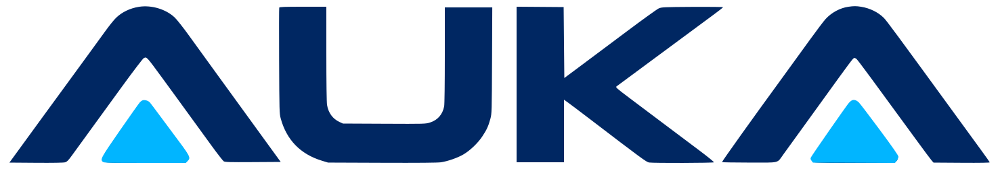
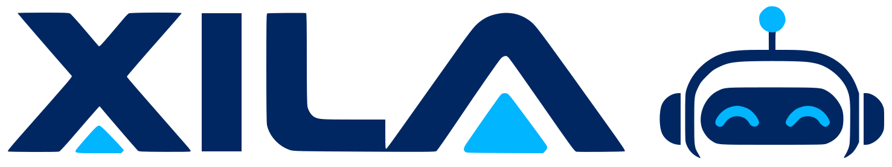
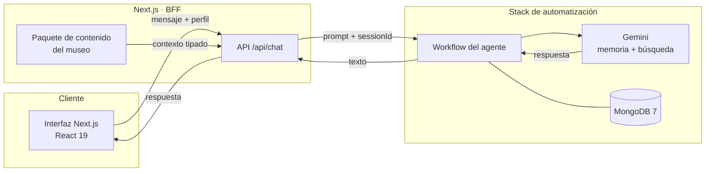

<p align="center">
  <picture>
    <source media="(prefers-color-scheme: dark)" srcset="https://raw.githubusercontent.com/miguelarb-842/sistema_auka/main/frontend/public/brand/auka-logo-oscuro.svg">
    <source media="(prefers-color-scheme: light)" srcset="https://raw.githubusercontent.com/miguelarb-842/sistema_auka/main/frontend/public/brand/auka-logo-claro.svg">
    
  </picture>
</p>

<h1 align="center">Sistema Auka</h1>

<p align="center">
  <strong>Una experiencia educativa que se instala en museos y conversa con sus visitantes.</strong>
</p>

<p align="center">
  <em>«La historia se piensa, no se copia.»</em>
</p>

<p align="center">
  
  
  
  
  
  
  
</p>

<p align="center">
  
  
  
  
</p>

<p align="center">
  <a href="#la-idea">La idea</a> ·
  <a href="#recorrido">Recorrido</a> ·
  <a href="#arquitectura">Arquitectura</a> ·
  <a href="#fases-de-trabajo">Fases</a> ·
  <a href="#puesta-en-marcha">Puesta en marcha</a>
</p>

---

> [!IMPORTANT]
> **Simulación educativa y contenido demostrativo.** Este repositorio **no es la web oficial del Museo Lolita Soriano**. Todo el contenido está marcado como **por verificar**: no se presentan biografías, fechas, obras, repertorios, integrantes, horarios ni precios como datos confirmados. Las conversaciones con personajes y agrupaciones son representaciones educativas, no citas ni testimonios reales.

## La idea

**Sistema Auka** es un producto educativo pensado para instalarse en museos, centros históricos y bibliotecas. Cada institución recibe un paquete de contenido propio con sus salas, su guía general, sus agentes Xila y sus conversaciones con personajes y agrupaciones.

> **El problema que origina Auka.** Muchas instituciones culturales no tienen guías permanentes; la información llega descoordinada y la IA genérica suele entregar respuestas listas para copiar. Auka propone acompañar el recorrido con preguntas, retos y contenido bajo control de la institución.

**Xila no reemplaza a los guías: los acompaña.** La experiencia está pensada para ampliar la conversación y el tiempo de atención, no para sustituir el trabajo humano. La meta no es que el visitante se lleve una respuesta para copiar, sino una pregunta para seguir pensando.

Este repositorio contiene una **simulación completa de esa instalación** en el **Museo Lolita Soriano**, en Managua, Nicaragua. Se puede recorrer, preguntar y conversar: la experiencia web está construida de punta a punta, pero su contenido sigue siendo demostrativo y debe validarse con el museo.

| Sistema Auka | Esta simulación |
| --- | --- |
| Producto instalable en museos, centros históricos y bibliotecas | Museo Lolita Soriano |
| Paquete de contenido por institución | 10 salas, 3 agentes Xila, 3 personajes y 1 agrupación invitada |
| Conversaciones adaptadas al visitante | 3 perfiles: Niño, Adolescente y Adulto |
| Interfaz + BFF + agente conversacional | Next.js 16, API propia y workflow de n8n con Gemini |

### Los nombres

La narrativa del proyecto une dos raíces originarias de Nicaragua:

| Nombre | Raíz | Sentido |
| --- | --- | --- |
| **Auka** | Miskito | Asociado al Árbol de Cortés (Handroanthus chrysanthus), de madera resistente y floración amarilla. |
| **Xila** | Chorotega-mangue | Traducido como «mujer»; una raíz precolombina del Pacífico de Nicaragua. |

Esa unión simboliza la identidad pluricultural del país: la plataforma toma el nombre de Auka y la voz que acompaña al visitante, el de Xila. En la experiencia web, Xila se presenta como agente conversacional en la guía general y en tres salas; el robot físico forma parte de la propuesta completa de Auka.

### Valores

| Valor | Inspiración | Cómo se vive en la experiencia |
| --- | --- | --- |
| **Curiosidad** | El cacique Nicarao, que preguntó antes de decidir. | Xila responde con preguntas, retos y pistas. |
| **Dignidad y valentía** | El cacique Diriangén, que pidió tiempo para responder y decidió con valentía. | Los personajes se presentan con contexto, no como caricaturas. |
| **Veracidad** | La información documentada y contrastada. | Lo que no está documentado se marca como **por verificar**. |
| **Identidad y memoria** | Los pueblos originarios y la historia local. | El contenido parte de Nicaragua y de sus comunidades. |
| **Cercanía** | El trato de la comunidad. | El tono se adapta al perfil y usa un español nicaragüense claro. |

## Recorrido

| Experiencia | Qué encontrás |
| --- | --- |
| **Recorrer el museo** | Diez salas con búsqueda y filtros, fichas de personajes y una agrupación invitada. Cada espacio tiene su propia descripción y sus vínculos curatoriales. |
| **Conversar con Xila** | Una guía general, tres agentes Xila ubicados en salas específicas, tres fichas de personajes y una agrupación invitada. Ocho conversaciones con voz, contexto y límites propios. |
| **Adaptar la visita** | El perfil cambia el tono, la extensión de las respuestas, las preguntas sugeridas y los retos. También podés elegir tema claro u oscuro, tamaño de texto y nivel de movimiento. |
| **Cuidar la experiencia** | Navegación móvil, atajos de teclado, estados de error claros, borradores de mensaje, cancelación de respuestas y reintento manual. |
| **Leer con criterio** | Cada contenido declara su estado. La interfaz no oculta lo que falta: lo marca como **por verificar** y explica por qué. |

### El museo en números

| 10 | 3 | 3 | 1 | 3 | 8 |
| :---: | :---: | :---: | :---: | :---: | :---: |
| salas | agentes Xila | personajes | agrupación invitada | perfiles de visitante | conversaciones |

Los agentes Xila están ubicados únicamente en la **Sala de Música**, la **Sala de Objetos Personales** y **El Rincón del Niño**. Las otras siete salas se recorren con contenido, pero sin agente propio.

## Tres perfiles, tres formas de mirar

| Perfil | Edad sugerida | Cómo cambia la conversación |
| --- | --- | --- |
| **Niño** | 6 a 11 años | Lenguaje breve, ejemplos cotidianos, preguntas sencillas y retos concretos. |
| **Adolescente** | 12 a 17 años | Preguntas de análisis, comparación y argumentación; retos de pensamiento crítico. |
| **Adulto** | 18 años en adelante | Contexto, matices, advertencias de fuentes y preguntas abiertas para seguir investigando. |

El perfil se elige en un onboarding inicial y puede cambiarse en **Configuración**. Al cambiarlo, la conversación abierta se reinicia con el nuevo tono.

## Una conversación con contexto

<p align="center">
  <picture>
    <source media="(prefers-color-scheme: dark)" srcset="https://raw.githubusercontent.com/miguelarb-842/sistema_auka/main/frontend/public/brand/xila-logo-oscuro.svg">
    <source media="(prefers-color-scheme: light)" srcset="https://raw.githubusercontent.com/miguelarb-842/sistema_auka/main/frontend/public/brand/xila-logo-claro.svg">
    
  </picture>
</p>

El chat no es una caja de texto suelta. Cada conversación tiene una identidad, un marco temporal cuando corresponde, un perfil pedagógico y un conjunto de reglas:

1. El visitante elige una guía, un agente de sala, un personaje o una agrupación.
2. El **BFF** de Next.js valida la petición y construye el prompt con el contexto del museo.
3. El prompt viaja al workflow de **n8n**, que usa **Gemini** con memoria por `sessionId` y búsqueda web.
4. La respuesta vuelve al BFF y se presenta en la interfaz con el tono del perfil elegido.

El navegador nunca habla directamente con el modelo ni recibe claves de API. Las reglas del prompt priorizan la búsqueda y el contenido documentado; cuando un dato no está confirmado, el agente debe decirlo en lugar de inventarlo.

## Arquitectura



- **Next.js 16 App Router** sirve la interfaz y la API. Las rutas de `app/` solo resuelven parámetros, metadata y composición.
- El **paquete de contenido** vive en `src/modules/museo/` y está separado de la UI. Los componentes piden datos a un servicio de solo lectura; no llevan el contenido del museo dentro.
- El **BFF** (`/api/chat` y rutas derivadas) valida, construye el prompt y delega la conversación en n8n. Así el cliente no expone credenciales ni lógica del agente.
- El **stack de automatización** corre aparte con n8n, MongoDB 7, Traefik y ngrok. No está incluido en este repositorio: se configura como servicio externo y se conecta mediante `N8N_CHAT_WEBHOOK_URL`. MongoDB 7 completa el stack como servicio de datos para los flujos de n8n.
- La app sigue **Screaming Architecture** para los dominios y **Atomic Design** para el sistema de diseño global.

### API propia

| Área | Endpoints |
| --- | --- |
| Información | `GET /api`, `GET /api/chat` |
| Museo | `GET /api/museo` |
| Salas | `GET /api/salas`, `GET /api/salas/:salaId`, `POST /api/salas/:salaId/chat` |
| Personajes | `GET /api/personajes`, `GET /api/personajes/:personajeId`, `POST /api/personajes/:personajeId/chat` |
| Agrupaciones | `GET /api/agrupaciones`, `GET /api/agrupaciones/:agrupacionId`, `POST /api/agrupaciones/:agrupacionId/chat` |
| Conversaciones | `GET /api/chat/conversaciones`, `GET /api/chat/conversaciones/:id`, `POST /api/chat` |

## Stack

| Capa | Tecnologías |
| --- | --- |
| Interfaz | Next.js 16 (App Router), React 19, TypeScript 5.9 en modo estricto |
| Diseño | Tailwind CSS 4, HeroUI 3, Lucide React, next-themes, Anime.js 4.5 (opt-in) |
| Contenido | Paquete tipado del museo, servicios de lectura, Screaming Architecture + Atomic Design |
| Servidor | Route Handlers de Next.js, validación de entrada, controllers, presenters y errores tipados |
| Agente | n8n, Gemini, memoria por `sessionId`, búsqueda web y prompt construido en el servidor |
| Infraestructura | Docker, n8n, MongoDB 7, Traefik y ngrok para el stack de automatización |
| Calidad | ESLint, Prettier, `tsc --noEmit`, Lighthouse y verificaciones CDP |

## Fases de trabajo

| Fase | Cuándo (2026) | Enfoque | Estado |
| --- | --- | --- | --- |
| **01 · Fundación y contenido** | 5–6 nov | Estructura Next.js + TypeScript, paquete del Museo Lolita Soriano, rutas, API RESTful y primer flujo con n8n y MongoDB. | ✅ Completada |
| **02 · Identidad y experiencia** | 8 nov | Identidad visual de Auka y Xila, sistema de diseño, onboarding, temas, tipografía, navegación móvil y animaciones opt-in. | ✅ Completada |
| **03 · Conversación y automatización** | 6–9 nov | Prompts por voz y perfil, webhook robusto, borradores, cancelación, reintento manual y estados de error. | ✅ Completada |
| **04 · Accesibilidad y rendimiento** | 8–9 nov | Teclado, foco visible, contraste, regiones `aria-live`, objetivos táctiles de 44 px, movimiento reducido y auditoría Lighthouse. | ✅ Completada |
| **05 · Publicación y validación** | Próximo | Despliegue público, dominio, SEO social, revisión editorial con el museo, CI y analítica con consentimiento. | 🚧 En curso |

> Las fases se solaparon durante el desarrollo. La tabla ordena áreas de trabajo, no un calendario rígido.

## Accesibilidad y rendimiento

La accesibilidad no se agregó al final: forma parte de las decisiones de interfaz.

- Enlace **«Saltar al contenido»**, landmarks semánticos y jerarquía de encabezados.
- Navegación completa por teclado, foco visible y `aria-pressed` en filtros y selectores.
- Regiones `aria-live` para la conversación y los estados dinámicos.
- Contraste verificado en tema claro y oscuro.
- Navegación móvil con objetivos táctiles de al menos **44 px**.
- Atajos `/` para enfocar la búsqueda y `Esc` para cerrar el diálogo de confirmación de reinicio.
- Preferencia de movimiento: **Automático** respeta `prefers-reduced-motion`; **Completo** es una decisión explícita del visitante.
- Preferencias de tipografía (pequeño, normal, grande) aplicadas globalmente.

| Señal | Resultado |
| --- | --- |
| Rendimiento móvil (Lighthouse) | **95–98** en las páginas principales |
| Accesibilidad (Lighthouse) | **100** |
| Cumulative Layout Shift | **0** |
| Comprobaciones CDP | **61/61** |
| TypeScript, ESLint y build | **sin errores** |

<sub>Medición local, noviembre de 2026. Los resultados pueden variar según dispositivo, red y configuración del stack de n8n.</sub>

<details>
<summary><strong>Nota técnica sobre el modo Completo</strong></summary>

El modo **Automático** es el valor predeterminado y respeta la preferencia del sistema. El modo **Completo** carga Anime.js incluso cuando el sistema pide movimiento reducido, porque el visitante lo eligió de forma explícita. En móvil, esa carga baja el rendimiento de la portada a ~72, aunque el CLS se mantiene en 0. Por eso el modo no es el valor por defecto.

</details>

## Puesta en marcha

**Requisitos:** Node.js 20 o superior y pnpm.

```bash
# 1. Clonar el repositorio
git clone https://github.com/miguelarb-842/sistema_auka.git
cd sistema_auka/frontend

# 2. Instalar dependencias
pnpm install

# 3. Configurar variables de entorno
cp .env.example .env.local
# editá .env.local con la URL de tu webhook de n8n

# 4. Levantar el servidor de desarrollo
pnpm dev
```

La aplicación queda disponible en `http://localhost:3000`.

### Variables de entorno

| Variable | ¿Obligatoria? | Descripción |
| --- | --- | --- |
| `NEXT_PUBLIC_SITE_URL` | No | URL pública para `metadataBase` y Open Graph. Por defecto usa `http://localhost:3000`. |
| `N8N_CHAT_WEBHOOK_URL` | Sí, para el chat | Webhook del workflow de n8n. Sin ella, el contenido funciona pero el chat responde que el servicio no está configurado. |
| `N8N_CHAT_TIMEOUT_MS` | No | Tiempo máximo de espera del agente. Por defecto, 60 000 ms; se limita al rango de 5 000 a 120 000 ms. |
| `N8N_CHAT_FALLBACK_URL` | No | URL alternativa para fallos transitorios. Los errores 4xx no se reintentan ni usan fallback. |

### Scripts

| Comando | Descripción |
| --- | --- |
| `pnpm dev` | Servidor de desarrollo |
| `pnpm build` | Build de producción |
| `pnpm start` | Servir el build de producción |
| `pnpm lint` | ESLint con corrección automática |
| `pnpm exec tsc --noEmit` | Verificación de tipos sin emitir archivos |

<details>
<summary><strong>Contrato del webhook n8n</strong></summary>

La aplicación envía un JSON como este:

```json
{
  "action": "sendMessage",
  "sessionId": "uuid-de-la-sesión",
  "chatInput": "prompt construido en el servidor",
  "conversacionId": "sala-musica",
  "perfil": "adulto"
}
```

El workflow debe devolver el texto en `output`, `text` o `response`; el servicio también tolera variantes anidadas. La app no reintenta automáticamente los 4xx. Para fallos transitorios puede usar `N8N_CHAT_FALLBACK_URL` si está configurada.

</details>

### Estructura del proyecto

```text
sistema_auka/
├── frontend/
│   ├── src/
│   │   ├── app/          # Rutas, layouts, estados y API de Next.js
│   │   ├── components/   # Sistema de diseño global (Atomic Design)
│   │   ├── modules/      # museo, salas, personajes, chat-xila, configuración, acerca
│   │   ├── config/       # Sitio, navegación y fuentes
│   │   └── types/        # Tipos compartidos
│   ├── public/brand/     # Logos de Auka y Xila
│   └── ...
├── README.md             # Esta presentación
└── .gitignore
```

## Contenido y criterios

El contenido se clasifica con tres etiquetas visibles:

| Etiqueta | Significado |
| --- | --- |
| **Documentado** | Información sostenida por documentación validada por el museo. |
| **Interpretación** | Lecturas y análisis del equipo del museo; no son hechos cerrados. |
| **Demostrativo** | Material introductorio de la simulación, pendiente de verificación. |

El modelo de producto propone que el contenido sea cargado y validado por especialistas de cada institución. En esta simulación, ese proceso todavía no ocurrió: por eso **todo el contenido está en estado demostrativo**. Las etiquetas **Documentado** e **Interpretación** quedan preparadas para cuando el museo entregue y valide su información.

Reglas del proyecto:

- No se inventan biografías, fechas, obras, repertorios, integrantes, horarios ni precios.
- Las representaciones de personajes y agrupaciones están marcadas como tales; no son citas ni testimonios.
- Las ilustraciones son representaciones conceptuales, no retratos verificados.
- Si un dato no está documentado, el agente debe señalarlo y ofrecer una alternativa dentro del museo.
- La verificación final queda a cargo del equipo del museo.

## Limitaciones y próximos pasos

Este proyecto es una **demo funcional**, no un producto terminado. Lo que falta también forma parte del diseño:

- **Validación editorial:** el contenido debe revisarse con el museo y pasar de demostrativo a documentado.
- **Alcance del prototipo:** este repositorio contiene la experiencia web navegable; el robot físico y la operación en cada institución forman parte de la propuesta completa.
- **Despliegue público:** falta publicar en un dominio estable y configurar `NEXT_PUBLIC_SITE_URL`.
- **Persistencia:** no hay cuentas, autenticación ni base de datos de usuarios. El historial de conversación no es permanente.
- **Dependencia externa:** el chat necesita el stack de n8n y el webhook configurado. Sin ellos, la app sigue siendo navegable, pero no conversa.
- **Reproducibilidad del agente:** el workflow de n8n se configura en la instancia. Este repositorio documenta el contrato del webhook y el cliente que lo consume, pero no incluye credenciales ni el JSON del workflow.
- **Infraestructura:** el stack de automatización se mantiene en un repositorio aparte y se configura como servicio externo.
- **Calidad continua:** la verificación actual es local; falta integrar `tsc`, lint, build y pruebas E2E en CI.
- **Rendimiento móvil:** el modo **Completo** de movimiento puede reducir el rendimiento de la portada; es opt-in y está documentado.

Próximos pasos sugeridos:

1. Publicar la app y configurar el dominio y las tarjetas sociales.
2. Revisar el contenido con el equipo del museo y actualizar las etiquetas.
3. Añadir CI con verificación de tipos, lint, build y pruebas de extremo a extremo.
4. Evaluar persistencia de conversaciones y cuentas si el producto lo necesita.
5. Medir uso con analítica respetuosa de la privacidad y consentimiento.

## Créditos

- **Idea, diseño y desarrollo:** [@miguelarb-842](https://github.com/miguelarb-842).
- **Stack de automatización:** n8n + MongoDB 7 + Docker + Traefik + ngrok, siguiendo la base de [n8n-automation-stack](https://github.com/WalterJiron/n8n-automation-stack).
- **Base de interfaz:** plantilla Next.js + HeroUI con licencia MIT. Ver [`frontend/LICENSE`](frontend/LICENSE).
- **Contenido del museo:** simulación educativa con contenido demostrativo pendiente de validación. No es una publicación oficial del Museo Lolita Soriano.

---

<p align="center">
  <em>Sistema Auka · Simulación educativa · 2026</em>
</p>

<p align="center">
  <sub>La historia se piensa, no se copia.</sub>
</p>
